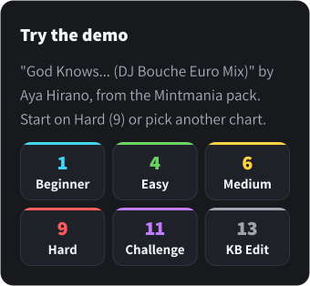
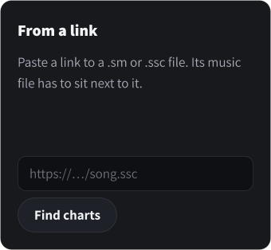
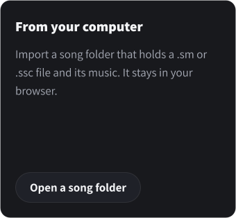

  <a href="https://chihduo.github.io/footnotes/">Website</a> ·
  <a href="https://chihduo.github.io/footnotes/guide/footnotes/">Guide</a> ·
  <a href="https://chihduo.github.io/footnotes/app/">Chart editor</a>

  
  
  

## See it in action

The recording loops beats 236–252 of “God Knows... (DJ Bouche Euro Mix)” on **Hard 9** at **75% playback**. Watch the blue left shoe hold the left panel at beat 241.5, then cross to the right panel at beat 244.

## Pick a song

Footnotes plays StepMania simfiles (`.sm` and `.ssc`) together with their music.

  
  
  

For more songs, the [Songs page](https://chihduo.github.io/footnotes/songs/) has the 52 songs of the Mintmania pack, with 257 charts, ready to practice.

## How it works

On Dance and Pump single and double charts, the 3D dancer shows which foot to use and how to shift your weight. The caption under the pad gives cues such as “Weight on right foot” or “Soften the landing.” The arrows scroll below the dancer on tall screens and beside it in a short, wide window, as in the recording.

  
  
  

Use **3D dancer** in the top bar to show or hide the dancer. The camera starts behind it, looking down at 45°. Drag over the pad to rotate, and scroll or pinch to zoom. The pad stays fixed while the dancer moves. Double-click to restore the rear view, or use **Fit** to see the whole body from your current angle.

On fast runs the dancer shortens its steps and keeps its feet low. If the suggested footing exceeds the movement limit at your playback rate, **Fast steps** appears in the upper-left corner. Click it to jump to the next flagged note. After the music and the last hold end, the dancer steps back to the center and turns to face the game screen.

## Controls

The assist tick marks each step and the metronome marks each beat. Both start enabled and go quiet when you pause or the music ends.

| Action                               | Keys                                                                                              |
| ------------------------------------ | ------------------------------------------------------------------------------------------------- |
| Play or pause                        | <kbd>Space</kbd>                                                                                  |
| Step, on a dance pad or the keyboard | <kbd>←</kbd> <kbd>↓</kbd> <kbd>↑</kbd> <kbd>→</kbd>                                               |
| Slower or faster                     | <kbd>Shift</kbd> + <kbd>←</kbd> / <kbd>→</kbd>                                                    |
| Scroll speed                         | <kbd>Shift</kbd> + <kbd>↑</kbd> / <kbd>↓</kbd>                                                    |
| Back to the start (chart focused)    | <kbd>Home</kbd>                                                                                   |
| Choose another chart                 | <kbd>Ctrl</kbd> + <kbd>Shift</kbd> + <kbd>O</kbd> (<kbd>⌘</kbd> <kbd>⇧</kbd> <kbd>O</kbd> on Mac) |
| Open the chart editor                | <kbd>Shift</kbd> + <kbd>H</kbd>                                                                   |

## Built on SMEditor

Footnotes is built on [SMEditor](https://github.com/tillvit/smeditor), an open source StepMania chart editor by tillvit.
Its [parity checker](https://chihduo.github.io/footnotes/guide/parity.html) assigns a foot to each arrow. Footnotes uses those assignments and the chart timing to animate the dancer.

Press <kbd>Shift</kbd>+<kbd>H</kbd> or choose **View > Dance practice mode** to switch between practice and editing. To open a chart directly in practice mode, use `app/?url=<simfile URL>&chartType=dance-single&chartIndex=0&flags=D`.

## Development

Run `npm ci` and `npm run dev`, then open the [local home page](http://127.0.0.1:5173/footnotes/) and choose **Try the demo song**.

| Command | What it does |
| --- | --- |
| `npm run dev` | Starts the Footnotes dev server |
| `npm run build` | Builds the site, app and guide into `dist/` |
| `npm run test:dancer` | Checks footing, body motion, model geometry and camera framing |
| `npm run test:practice-audio` | Checks assist tick and metronome timing in practice |
| `npm run guide:dev` | Starts the guide’s dev server |
| `npm run app:dev` | Runs the desktop app against the dev server |

Every push to `master` builds the site and publishes it to GitHub Pages (`.github/workflows/bundle.yml`).

The demo and the Songs page load their songs from https://chihduo.github.io/footnotes-packs/, published from [chihduo/footnotes-packs](https://github.com/chihduo/footnotes-packs).
To try a local copy, serve it and start the dev server with `VITE_PACKS_URL` set to its address, such as `VITE_PACKS_URL=http://127.0.0.1:8765/ npm run dev`.

| Path                               | Contents                                                     |
| ---------------------------------- | ------------------------------------------------------------ |
| `index.html`, `songs/`, `landing/` | The Footnotes website: home page, song picker and Songs page |
| `app/`                             | The app: SMEditor with dance practice mode                   |
| `guide/`                           | The guide (VitePress)                                        |
| `public/demo/`                     | Bundled copy of "YOU" by YURIA                               |
| `.github/readme/`                  | The images in this README                                    |
| `tools/readme/`                    | The script that generates them from the website's design     |

The title illustration, buttons and cards use SVGs with outlined text. The GIF in **See it in action** comes from the website’s silent recording at `public/media/footnotes-preview.webm`. After updating the recording or card artwork, regenerate the README images with `python3 tools/readme/make_readme_images.py` (requires `fonttools`, `brotli`, `uharfbuzz` and `ffmpeg`).

## License

Footnotes is a modified version of SMEditor and is distributed under the MIT License, like SMEditor. See [LICENSE](LICENSE).

The practice dancer’s head and hands are adapted from the [MakeHuman base mesh](https://github.com/makehumancommunity/makehuman/blob/a8bc2d54ff0ac92e78ff71431b1023eda42bf482/makehuman/data/3dobjs/base.obj), released under [CC0](https://github.com/makehumancommunity/makehuman/blob/a8bc2d54ff0ac92e78ff71431b1023eda42bf482/LICENSE.ASSETS.md).

The bundled song in `public/demo/`, "YOU" by YURIA with charts by Trick Master Mint and Shuffle Master Mint, is included with permission. It isn't covered by the MIT License and may not be redistributed.

The song packs on the Songs page are hosted separately, in [chihduo/footnotes-packs](https://github.com/chihduo/footnotes-packs), and aren't covered by the MIT License either.
