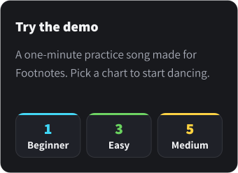
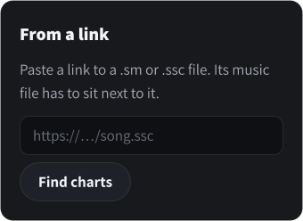
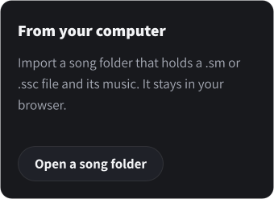
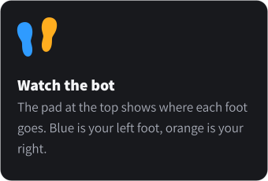
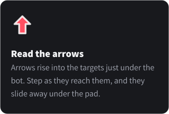
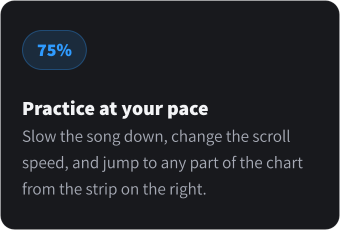
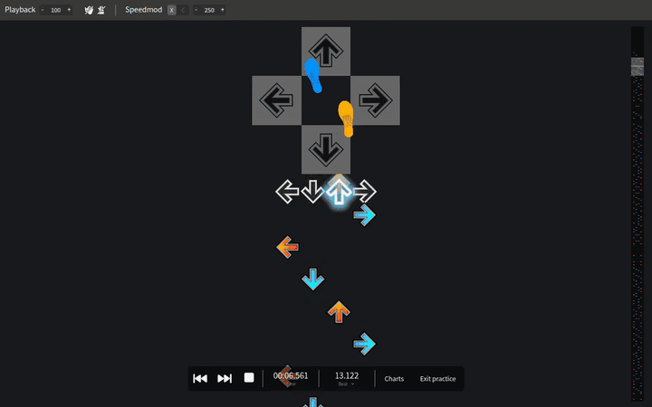

  <a href="https://chihduo.github.io/footnotes/">Website</a> ·
  <a href="https://chihduo.github.io/footnotes/guide/footnotes/">Guide</a> ·
  <a href="https://chihduo.github.io/footnotes/app/">Chart editor</a>

  
  

## Pick a song

Footnotes plays StepMania simfiles (`.sm` and `.ssc`) together with their music.

  
  
  

## How it works

  
  
  

## See it in action

The demo song's Medium chart: the bot crosses its feet over, and the arrows below show what's coming next.

## Controls

Everything you need while practicing stays on screen. These keys make it quicker.

| Action                | Keys                                                                                              |
| --------------------- | ------------------------------------------------------------------------------------------------- |
| Play or pause         | <kbd>Space</kbd>                                                                                  |
| Slower or faster      | <kbd>Shift</kbd> + <kbd>←</kbd> / <kbd>→</kbd>                                                    |
| Scroll speed          | <kbd>Shift</kbd> + <kbd>↑</kbd> / <kbd>↓</kbd>                                                    |
| Back to the start     | <kbd>Home</kbd>                                                                                   |
| Choose another chart  | <kbd>Ctrl</kbd> + <kbd>Shift</kbd> + <kbd>O</kbd> (<kbd>⌘</kbd> <kbd>⇧</kbd> <kbd>O</kbd> on Mac) |
| Open the chart editor | <kbd>Shift</kbd> + <kbd>H</kbd>                                                                   |

## Built on SMEditor

Footnotes is built on [SMEditor](https://github.com/tillvit/smeditor), an open source StepMania chart editor by tillvit.
SMEditor works out the most natural foot for every arrow with its [parity checker](https://chihduo.github.io/footnotes/guide/parity.html) and can show the result as a small dancing bot.
Footnotes adds a **dance practice mode** around it:

- The bot is enlarged and placed above the notefield, with the receptors directly underneath. Arrows rise into the receptors and slide under the bot once they pass.
- The editing interface is hidden. Playback controls, playback rate, scroll speed, the assist tick and the note layout stay.
- The website loads a song from a link, lists its charts, and opens the chosen chart in practice mode.

Practice mode is toggled with <kbd>Shift</kbd>+<kbd>H</kbd> or **View > Dance practice mode**, and the `D` URL flag opens a song straight into it:
`app/?url=<link to .sm/.ssc>&chartType=dance-single&chartIndex=0&flags=D`.

## Development

| Command             | What it does                                              |
| ------------------- | --------------------------------------------------------- |
| `npm run dev`       | Starts a dev server at `http://127.0.0.1:5173/footnotes/` |
| `npm run build`     | Builds the site, app and guide into `dist/`               |
| `npm run guide:dev` | Starts the guide's dev server                             |
| `npm run app:dev`   | Runs the desktop app against the dev server               |

Every push to `master` builds the site and publishes it to GitHub Pages (`.github/workflows/bundle.yml`).

| Path                     | Contents                                                 |
| ------------------------ | -------------------------------------------------------- |
| `index.html`, `landing/` | The Footnotes website: home page and song picker         |
| `app/`                   | The app: SMEditor with dance practice mode               |
| `guide/`                 | The guide (VitePress)                                    |
| `public/demo/`           | The demo song                                            |
| `tools/demo-song/`       | The script that generates the demo song                  |
| `.github/readme/`        | The images in this README                                |
| `tools/readme/`          | The script that generates them from the website's design |

The README images are SVGs with their text converted to outlines, so they look the same as the website on GitHub.
After changing the website's look, regenerate them with `python3 tools/readme/make_readme_images.py` (it needs `fonttools`, `brotli`, `uharfbuzz` and `ffmpeg`).

## License

Footnotes is a modified version of SMEditor and is distributed under the MIT License, like SMEditor. See [LICENSE](LICENSE).

The demo song in `public/demo/` is generated from scratch by `tools/demo-song/make_demo_song.py` and is released into the public domain ([CC0](https://creativecommons.org/publicdomain/zero/1.0/)).
