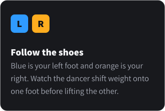
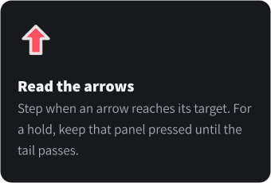
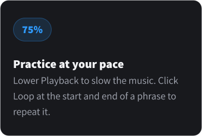
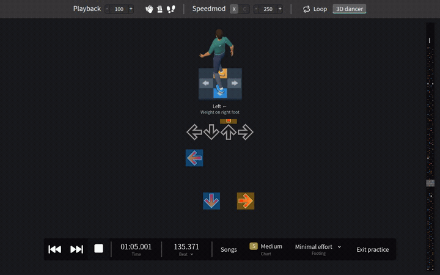

  <a href="https://chihduo.github.io/footnotes/">Website</a> ·
  <a href="https://chihduo.github.io/footnotes/guide/footnotes/">Guide</a> ·
  <a href="https://chihduo.github.io/footnotes/app/">Chart editor</a>

  
  
  

## Pick a song

Footnotes plays StepMania simfiles (`.sm` and `.ssc`) together with their music.

  
  
  

For more songs, the [Songs page](https://chihduo.github.io/footnotes/songs/) has the 52 songs of the Mintmania pack, with 257 charts, ready to practice.

## How it works

On Dance and Pump single and double charts, the 3D dancer stands on the pad above the arrows. The camera starts directly behind the dancer, looking down at the pad at 45°. Drag over the pad to orbit or tilt the camera. Use the wheel or pinch to zoom. The pad stays fixed as the dancer shifts weight, turns, and lands. Double-click for the starting view, or use **Fit** to see the whole dancer at your current angle. The **3D dancer** button in the top bar shows or hides the dancer.

For dense passages, the dancer chooses shorter landings inside each arrow and keeps its feet close to the pad. Music and foot strikes follow the selected playback rate. If a planned step exceeds the movement limit, a cue under the dancer shows its foot, arrow, and beat. Click **Fast steps** to jump between flagged notes.

To try the dancer in this checkout, run `npm ci` and `npm run dev`, then [open the local Medium practice chart](http://127.0.0.1:5173/footnotes/app/?url=../demo/you.sm&chartType=dance-single&chartIndex=2&flags=D). Beat 144 has a left-foot crossover.

  
  
  

## See it in action

A Medium chart: the bot crosses its feet over, and the arrows below show what's coming next.

## Controls

Everything you need while practicing stays on screen. These keys make it quicker.

| Action                               | Keys                                                                                              |
| ------------------------------------ | ------------------------------------------------------------------------------------------------- |
| Play or pause                        | <kbd>Space</kbd>                                                                                  |
| Step, on a dance pad or the keyboard | <kbd>←</kbd> <kbd>↓</kbd> <kbd>↑</kbd> <kbd>→</kbd>                                               |
| Slower or faster                     | <kbd>Shift</kbd> + <kbd>←</kbd> / <kbd>→</kbd>                                                    |
| Scroll speed                         | <kbd>Shift</kbd> + <kbd>↑</kbd> / <kbd>↓</kbd>                                                    |
| Back to the start                    | <kbd>Home</kbd>                                                                                   |
| Choose another chart                 | <kbd>Ctrl</kbd> + <kbd>Shift</kbd> + <kbd>O</kbd> (<kbd>⌘</kbd> <kbd>⇧</kbd> <kbd>O</kbd> on Mac) |
| Open the chart editor                | <kbd>Shift</kbd> + <kbd>H</kbd>                                                                   |

## Built on SMEditor

Footnotes is built on [SMEditor](https://github.com/tillvit/smeditor), an open source StepMania chart editor by tillvit.
SMEditor works out the most natural foot for every arrow with its [parity checker](https://chihduo.github.io/footnotes/guide/parity.html) and can show the result as a small dancing bot.
Footnotes adds a **dance practice mode** around it:

- The bot is enlarged and placed above the notefield, with the receptors directly underneath. Arrows rise into the receptors and slide under the bot once they pass.
- The editing interface is hidden. Playback controls, playback rate, scroll speed, the assist tick and the note layout stay.
- The website loads a song from a link, lists its charts, and opens the chosen chart in practice mode.

Practice mode is toggled with <kbd>Shift</kbd>+<kbd>H</kbd> or **View > Dance practice mode**, and the `D` URL flag opens a song straight into it:
`app/?url=<link to .sm/.ssc>&chartType=dance-single&chartIndex=0&flags=D`.

## Development

| Command             | What it does                                              |
| ------------------- | --------------------------------------------------------- |
| `npm run dev`       | Starts a dev server at `http://127.0.0.1:5173/footnotes/` |
| `npm run build`     | Builds the site, app and guide into `dist/`               |
| `npm run test:dancer` | Checks dancer motion, seeking, panel resizing and camera framing |
| `npm run guide:dev` | Starts the guide's dev server                             |
| `npm run app:dev`   | Runs the desktop app against the dev server               |

Every push to `master` builds the site and publishes it to GitHub Pages (`.github/workflows/bundle.yml`).

The Songs page reads its song packs from https://chihduo.github.io/footnotes-packs/, published from [chihduo/footnotes-packs](https://github.com/chihduo/footnotes-packs).
To try a local copy, serve it and start the dev server with `VITE_PACKS_URL` set to its address, such as `VITE_PACKS_URL=http://127.0.0.1:8765/ npm run dev`.

| Path                               | Contents                                                     |
| ---------------------------------- | ------------------------------------------------------------ |
| `index.html`, `songs/`, `landing/` | The Footnotes website: home page, song picker and Songs page |
| `app/`                             | The app: SMEditor with dance practice mode                   |
| `guide/`                           | The guide (VitePress)                                        |
| `public/demo/`                     | The demo song                                                |
| `.github/readme/`                  | The images in this README                                    |
| `tools/readme/`                    | The script that generates them from the website's design     |

The README images are SVGs with their text converted to outlines, so they look the same as the website on GitHub.
After changing the website's look, regenerate them with `python3 tools/readme/make_readme_images.py` (it needs `fonttools`, `brotli`, `uharfbuzz` and `ffmpeg`).

## License

Footnotes is a modified version of SMEditor and is distributed under the MIT License, like SMEditor. See [LICENSE](LICENSE).

The practice dancer’s head and hands are adapted from the [MakeHuman base mesh](https://github.com/makehumancommunity/makehuman/blob/a8bc2d54ff0ac92e78ff71431b1023eda42bf482/makehuman/data/3dobjs/base.obj), released under [CC0](https://github.com/makehumancommunity/makehuman/blob/a8bc2d54ff0ac92e78ff71431b1023eda42bf482/LICENSE.ASSETS.md).

The demo song in `public/demo/`, "YOU" by YURIA with charts by Trick Master Mint and Shuffle Master Mint, is included with permission. It isn't covered by the MIT License and may not be redistributed.

The song packs on the Songs page are hosted separately, in [chihduo/footnotes-packs](https://github.com/chihduo/footnotes-packs), and aren't covered by the MIT License either.
