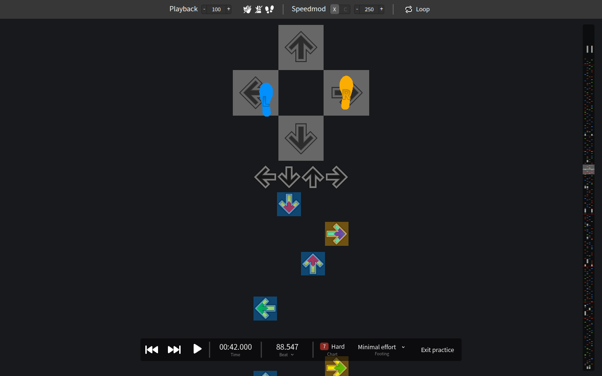

# Getting started

Footnotes helps you learn how to dance a StepMania chart.
A dancing bot stands on a dance pad at the top of the screen and steps exactly when you should, right above the arrows you're about to hit.
Copy its feet while you read the arrows, and slow the song down until the pattern feels natural.

## Your first song

1. Open [Footnotes](https://chihduo.github.io/footnotes/) and press **Try the demo song**. It opens the **Hard** chart of "YOU" by YURIA. For an easier start, pick **Beginner** or **Easy** in the **Try the demo** card instead.
2. Press <kbd>Space</kbd> or the play button to start the song, and watch the bot.
3. If it's too fast to follow, lower **Playback** in the top bar to slow the song down, and use **Loop** to repeat a hard part.

To practice your own songs, see [Loading songs](./loading-songs).

## Reading the bot

- The pad at the top is the dance stage, seen from above. Blue is your **left** foot and orange is your **right** foot, and each foot is labeled **L** or **R**.
- A foot moves onto a panel just as the arrow for that panel reaches the targets. The panel lights up when it's stepped on.
- When a foot steps again on the panel it's already standing on, it disappears for a moment and reappears exactly on the beat, like a tap. In a jump on the same two panels, both feet do this.
- A foot that holds a panel for a hold note stays on it until the hold ends.
- When the chart asks you to cross over or turn, the bot's feet cross and turn too.

The bot plans the footing for the whole chart: it moves your feet as little as it can and avoids swinging a foot across the pad, alternates feet when that's comfortable, steps twice with the same foot when steps are slow, and never puts both feet on one arrow or one foot on two arrows.
[How the bot chooses your feet](./footing) explains the rules.
The footing is a suggestion, so trust your body when a step feels wrong.

## The practice screen

1. **Top bar:** playback rate, the assist tick and metronome, scroll speed, foot highlights, and **Loop** to repeat a section.
2. **Dancing bot:** the pad with the two feet.
3. **Targets:** arrows rise into these, just under the bot. Once an arrow passes the targets, it slides away under the pad.
4. **Note layout:** the strip on the right shows the whole chart. Click or drag on it to jump to any part of the song.
5. **Bottom bar:** skip to the start or end, play or pause, the current time and beat, **Chart** to see and switch the difficulty, **Footing** to choose how the bot picks your feet, and **Exit practice**.

On a phone held sideways, the screen is too short to stack the bot above the targets, so the bot goes on the left with the targets beside it, both shown larger.

See [Controls](./controls) for all the buttons and keys.

## Leaving practice mode

Press **Exit practice** or <kbd>Shift</kbd>+<kbd>H</kbd> to switch to the full SMEditor chart editor, with all of its menus and tools.
Press <kbd>Shift</kbd>+<kbd>H</kbd> again, or choose **View > Dance practice mode**, to come back.
